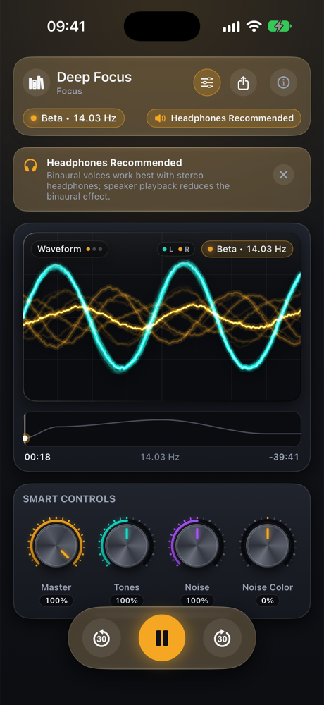
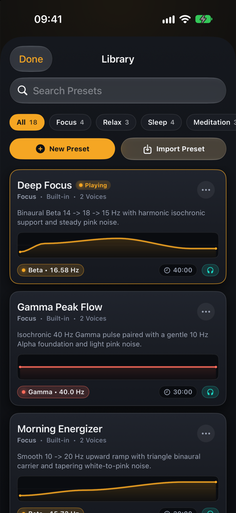
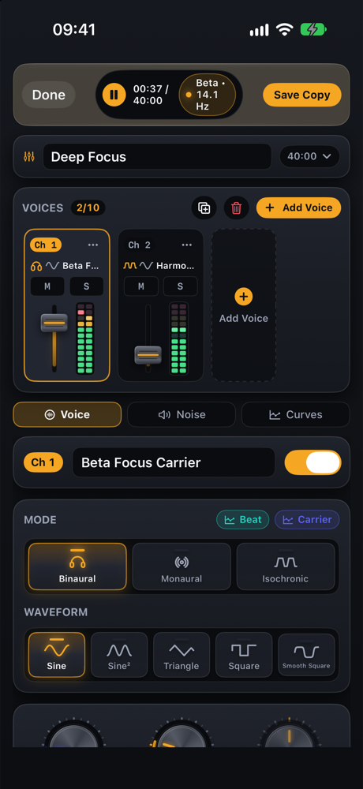
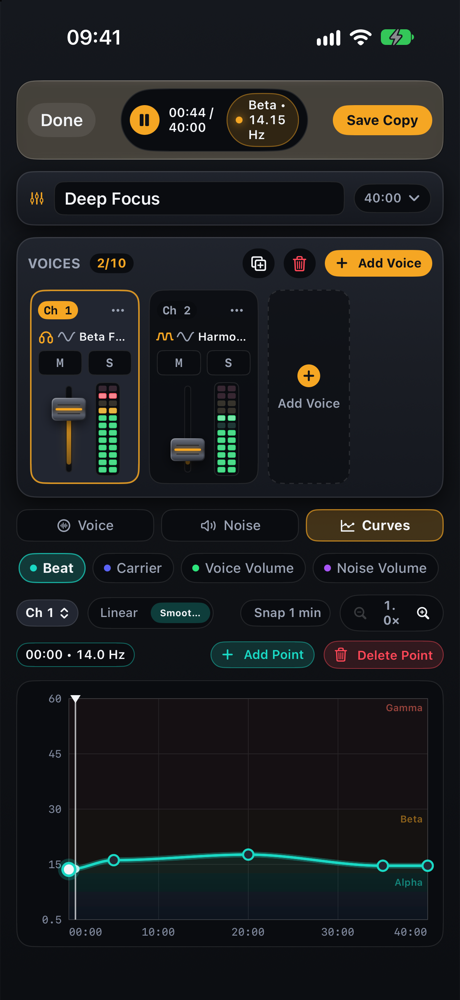

# Sintonia

**Brainwave entrainment studio for iPhone, iPad and Mac.** Sintonia generates binaural, monaural and isochronic tones with colored noise in real time, lets you shape every parameter over the session with automation curves, and exports finished sessions as audio files.

<p align="center">
  
  
  
</p>

<p align="center">
  
</p>

## Features

**Synthesis**
- Up to 10 voices per preset, each **binaural**, **monaural** or **isochronic**.
- Five waveforms: sine, sine², triangle, square and smooth square.
- Stereo colored noise from white through pink to brown. Optional pulsing locked to a voice's beat.
- Voice tracking: a voice can follow another voice's carrier or beat by a ratio and an offset (for example, a pure fifth).
- Real-time engine in Swift 6. Snapshots reach the audio thread through a lock-free triple buffer. The render path allocates no memory and takes no locks. Parameters glide over 15 ms, and seeks, preset switches and pauses are click-free.

**Player**
- Live stereo oscilloscope with phosphor trails, showing the current brainwave band (δ, θ, α, β, γ) and beat frequency.
- Master, tones, noise and noise-color smart controls, ±30 s skip and a session timeline.
- Lock Screen and Control Center Now Playing, remote commands and background audio.
- Headphone-aware routing. Sintonia recommends headphones for binaural presets and pauses when they are unplugged.

**Studio**
- Mixer-style rack with mute, solo, level meters, and buttons to add, duplicate and delete voices.
- Curve editor for beat, carrier, voice volume and noise volume. Choose linear or smooth-step interpolation, snap to a grid, zoom, and see brainwave band overlays.
- Every edit is heard instantly while playback continues. Edits to built-in presets are saved as copies.

**Library and files**
- 18 built-in presets: Focus (4), Relax (3), Sleep (4), Meditation (3), Study (2) and Creative (2).
- Imports classic **BrainWave Generator `.bwg`** files, both text and legacy binary. Imports are sanitized and come with a warnings report.
- Native **`.sintonia`** preset documents (versioned JSON), shared through the share sheet or Files. Legacy `.waveforge` files still import.
- Offline export to **WAV** (48 kHz, 24-bit) or **M4A** (AAC, 256 kbps), rendered faster than real time.

**Mac**
- Separate Player, Library and Studio windows, plus a menu bar extra.
- Pick the CoreAudio output device. Switching devices fades out and back in.
- Drag and drop files to import. Menu commands with keyboard shortcuts, including Space for play/pause.

Sintonia is localized in English and Russian.

## Requirements

- Xcode with the iOS 27.2 and macOS 27.2 SDKs (Swift 6.2, strict concurrency).
- [XcodeGen](https://github.com/yonaskolb/XcodeGen), which generates the Xcode project from `project.yml`.

## Getting started

```bash
git clone https://github.com/legenki/sintonia.git
```

```bash
cd sintonia && xcodegen generate
```

```bash
open Sintonia.xcodeproj
```

Then pick a scheme:

| Scheme        | Platform        |
|---------------|-----------------|
| `Sintonia`    | iPhone and iPad |
| `SintoniaMac` | macOS           |

To sign for a device, set your own `DEVELOPMENT_TEAM` in `project.yml` and run `xcodegen generate` again.

## Tests

Core package (synthesis, presets, importer, exporter):

```bash
cd Packages/SintoniaCore && swift test
```

App tests:

```bash
xcodebuild test -project Sintonia.xcodeproj -scheme SintoniaMac -destination 'platform=macOS'
```

```bash
xcodebuild test -project Sintonia.xcodeproj -scheme Sintonia -destination 'platform=iOS Simulator,name=iPhone 18 Pro'
```

## Project structure

```
Packages/SintoniaCore/          Swift package, no UI dependencies
  Sources/SynthCore/           Real-time renderer, waveforms, noise, snapshot channel, telemetry
  Sources/PresetKit/           Preset model, validator, curve compiler, .bwg importer, JSON codec, store
  Sources/SintoniaExport/      Offline WAV/M4A exporter and audio route policy
App/Sources/AudioRuntime/      AVAudioEngine controller, Now Playing, CoreAudio device manager (macOS)
App/Sources/StudioUI/          Shared SwiftUI: player, library, studio, curve editor, controls
App/Sources/MacUI/             macOS windows, menu bar extra, commands, drag and drop
App/iOS, App/Mac               App entry points and platform Info.plists
App/Resources                  Assets, string catalog (EN/RU), privacy manifest
project.yml                    XcodeGen project definition
```

## Disclaimer

Sintonia is an audio tool for relaxation, focus and experimentation. It is not a medical device and makes no therapeutic claims. People with epilepsy or a history of seizures should talk to a doctor before using rhythmic audio stimulation. Do not use it while driving or operating machinery.
